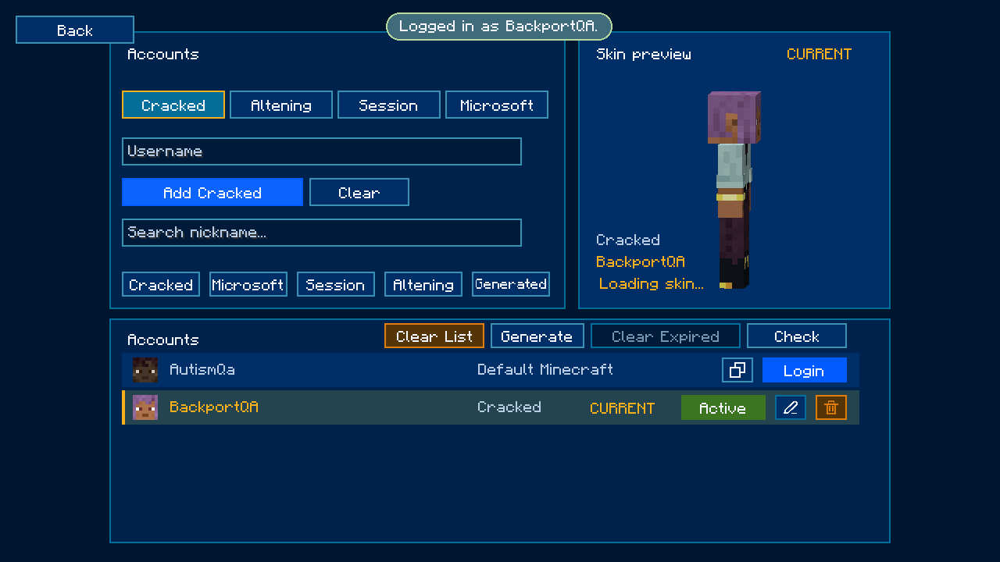

# Minecraft 1.21.11 backport

[Download the installable JAR](autism-account-manager-5.0-backport.2+1.21.11.jar).

Requires Minecraft 1.21.11, Fabric Loader 0.20.1 or newer, Java 21 or newer, and
Fabric API 0.141.6+1.21.11. Install the JAR in the instance's `mods` folder and
open **Multiplayer → Accounts**.

The JAR is the exact artifact tested in a fresh production-mode instance on
Java 21.0.13. Seventeen runtime checks passed; see [validation.json](validation.json).
DPAPI interoperability with the original 26.2 build passed in both directions
using synthetic data. Microsoft OAuth, real session tokens, TheAltening,
multiplayer authentication, other mods, and Linux/macOS remain untested.

Source and build instructions are at the repository root. Original authorship
belongs to Melonik; this is an unofficial account-manager backport.

